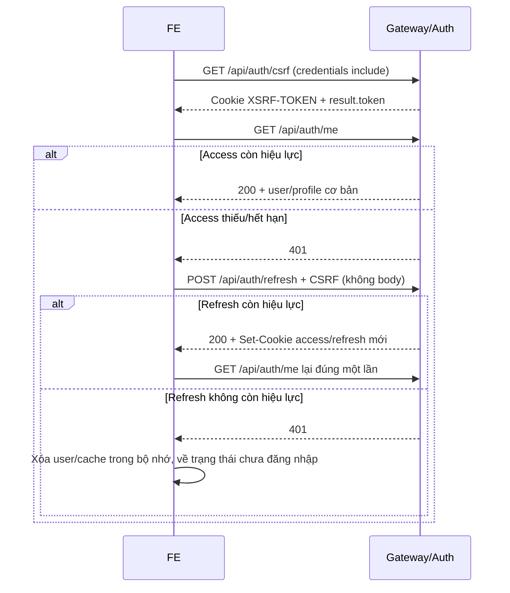

# Hợp đồng triển khai FE — Auth, Profile, Avatar, Điểm danh

Ngày đối chiếu code: **19/10/2026**. Tài liệu dành cho FE tích hợp phần BE của Khanh trong `auth-service` và `api-gateway`.
Hợp đồng bên dưới dựa trên controller, DTO, service và security hiện tại; không coi route giữ chỗ là tính năng đã có.
Ví dụ email, UUID, ngày giờ, token và URL S3 chỉ để minh họa; FE phải dùng giá trị BE thực sự trả về.

**Ưu tiên đợt tích hợp FE đầu tiên:** đăng ký/OTP → login → `/me` → khôi phục phiên/refresh → logout qua gateway.
Nối các tính năng tài khoản còn lại sau khi luồng này ổn. Phần `/ws-token` chỉ là API auth đã chuẩn bị;
FE chưa cần nối game/STOMP/shop/wallet để hoàn thành đợt auth, và không cần chờ các phần tích hợp đó.

Tra cứu nhanh: [quyền/API](#4-danh-sách-api-và-quyền), [đăng ký](#5-đăng-ký-và-otp-email),
[phiên đăng nhập](#6-phiên-đăng-nhập), [mật khẩu](#7-quên-đặt-lại-và-đổi-mật-khẩu),
[profile](#8-hồ-sơ-cá-nhân-và-lấy-tênavatar-theo-id), [avatar user](#9-avatar-chọn-danh-mục-hoặc-upload-cá-nhân),
[avatar admin](#10-admin-quản-lý-avatar-có-sẵn), [điểm danh](#12-điểm-danh-hằng-ngày),
[HTTP client mẫu](#13-http-client-mẫu-cho-fe), [bảng lỗi](#14-bảng-lỗi-dùng-chung).

## 1. Địa chỉ và phạm vi

| Mục | Local mặc định |
|---|---|
| FE | `http://localhost:5173` |
| API base URL qua gateway | `http://localhost:8080` |
| Swagger | `http://localhost:8080/swagger-ui.html` |
| OpenAPI JSON | `http://localhost:8080/v3/api-docs` |
| Auth trực tiếp để chẩn đoán | `http://localhost:8090` |

FE cấu hình, ví dụ với Vite:

```dotenv
VITE_API_BASE_URL=http://localhost:8080
```

Các đường dẫn `/api/...` trong tài liệu được nối vào base URL này. FE gọi gateway; gateway chuyển tiếp về auth,
giữ nguyên method/path/query/body. HTTP có xác thực dùng cookie, không cần FE tự gọi JWKS hoặc tự verify JWT.
Ảnh S3 upload/hiển thị đi **trực tiếp giữa FE và S3** bằng URL BE trả, không nối thêm base URL gateway.

Giữ thống nhất hostname `localhost` khi test; không trộn `localhost` với `127.0.0.1` vì cookie và CORS sẽ khác.
Nếu đổi origin FE, BE cần cho phép origin đó ở cả gateway và auth. HTTPS/deploy cấu hình cookie/CORS do BE phụ trách.

Đã có: đăng ký + OTP, login/refresh/logout, thông tin người dùng, quên/reset/đổi mật khẩu,
xem/sửa profile, profile batch, avatar do admin quản lý trên S3, upload ảnh cá nhân, điểm danh/lịch tháng,
và API lấy access token cho STOMP.

Chưa có trong hợp đồng này: logout-all/quản lý thiết bị, khóa do login sai, điểm danh bù/thưởng chuỗi,
quản lý user/report/penalty/restriction, thưởng lần login đầu, API số dư ví và luồng game/STOMP hoàn chỉnh.
Một số prefix đã có route gateway nhưng chưa có controller nghiệp vụ. FE không suy ra API chỉ từ route hoặc SPEC dự kiến.

## 2. Quy ước request và response

### 2.1. Request

- Tất cả request đến BE dùng `credentials: "include"` với fetch hoặc `withCredentials: true` với Axios.
- Body JSON dùng `Content-Type: application/json`. GET không gửi body; query phải URL-encode.
- API ghi cần CSRF theo bảng mục 4. Không tự gắn header `Cookie` trong JavaScript; trình duyệt xử lý.
- Không tự gửi `accountId`, `role`, `X-User-Id`, `X-User-Role` để quyết định người thao tác.
  BE lấy danh tính từ access cookie; gateway loại header danh tính/Authorization do client tự gửi.
- Các HTTP API trong tài liệu không dùng `Authorization: Bearer ...`. Header Bearer trong **frame STOMP CONNECT** là trường hợp riêng, xem mục 11.

### 2.2. Response thành công

BE bọc dữ liệu bằng `ApiResponse`:

```json
{
  "code": "success_request",
  "message": "Lấy thông tin đăng nhập thành công.",
  "result": {
    "accountId": "019a9231-0000-7000-8000-000000000001",
    "email": "khanh@example.com",
    "role": "USER",
    "profile": {
      "accountId": "019a9231-0000-7000-8000-000000000001",
      "displayName": "Khanh",
      "avatarUrl": null
    }
  },
  "timestamp": "2026-10-19T03:00:00Z",
  "path": "/api/auth/me"
}
```

`result` mới là dữ liệu nghiệp vụ. **Mọi ví dụ “result” ở các API bên dưới đều nằm trong envelope này.**
`code` thành công là `success_request`, không phải `SUCCESS` hay `200`.
`message` là thông báo để hiển thị, không dùng để phân nhánh nghiệp vụ; dùng HTTP status, `code` lỗi hoặc field trạng thái.

Các thao tác không trả dữ liệu như logout/forgot/reset/change-password vẫn trả HTTP 200 và JSON envelope,
nhưng **không có field `result`**:

```json
{
  "code": "success_request",
  "message": "Đăng xuất thành công.",
  "timestamp": "2026-10-19T03:00:00Z",
  "path": "/api/auth/logout"
}
```

Field null của envelope được bỏ qua; bên trong DTO có thể có null, ví dụ `avatarUrl`, `rewardedAt`.
UUID là string, `Instant` là chuỗi ISO-8601 UTC, ngày là `yyyy-MM-dd`, tháng là `yyyy-MM`.
FE phải chấp nhận timestamp có phần thập phân giây; không cắt chuỗi theo độ dài cố định.
Số xu là số nguyên. Các giới hạn/TTL ghi “mặc định” có thể được BE đổi bằng cấu hình.

### 2.3. Response lỗi

```json
{
  "code": "AUTH_INVALID_CREDENTIALS",
  "message": "Email hoặc mật khẩu không đúng.",
  "timestamp": "2026-10-19T03:00:00Z",
  "requestId": "a353f28c-3eb1-40dc-801a-bad237b51469"
}
```

Lỗi không có `result`, `path` hoặc danh sách lỗi field. Validation body/query thường trả lỗi chung
`AUTH_INVALID_REQUEST`; FE cần tự validate và gắn lỗi vào input trước khi gửi.
Gateway có thể trả `GATEWAY_*` cùng dạng lỗi trên. Header response `X-Request-Id` giúp gửi mã tra cứu lỗi cho BE.
Network/CORS/proxy có thể trả body rỗng hoặc không phải JSON; client vẫn phải xử lý theo HTTP/network error.

## 3. Cookie, CSRF và khôi phục phiên

### 3.1. Token nằm ở đâu?

| Giá trị | Ai quản lý? | Cách FE dùng |
|---|---|---|
| `accessToken` | BE set cookie HttpOnly, path `/` | Trình duyệt tự gửi; FE không đọc/lưu JWT cho HTTP |
| `refreshToken` | BE set cookie HttpOnly, path `/api/auth` | Trình duyệt tự gửi khi gọi refresh/logout; không có trong JSON login |
| `XSRF-TOKEN` | BE set cookie HttpOnly, path `/` | Trình duyệt tự gửi; FE lấy bản token qua response `/csrf` |
| CSRF token trong JSON | FE giữ trong bộ nhớ | Gửi lại bằng header `X-XSRF-TOKEN` khi API yêu cầu |

Local Docker mặc định `SameSite=Lax`, `Secure=false`. FE không tự tạo/xóa hai cookie auth;
logout/reset/change-password thành công sẽ nhận `Set-Cookie` xóa từ BE.
Không tìm access/refresh token trong `document.cookie`, response login hay localStorage.

### 3.2. Lấy CSRF token

**GET `/api/auth/csrf`** — public, không query, không body, không cần access token.

HTTP **200**, result:

```json
{
  "headerName": "X-XSRF-TOKEN",
  "token": "6b4df283-07e3-4bfb-a69a-8eef3ba019bc"
}
```

BE đồng thời set cookie `XSRF-TOKEN`. FE giữ `result.token` trong bộ nhớ, rồi gửi:

```http
X-XSRF-TOKEN: 6b4df283-07e3-4bfb-a69a-8eef3ba019bc
```

Không gửi `{headerName, parameterName, token}` lên BE. Đây là dữ liệu **trả về**, không phải request.
Không phải gọi `/csrf` trước mỗi API. Lấy khi khởi tạo app và dùng lại cho login/refresh/logout/các thao tác ghi.
Sau khi reload trang mất bộ nhớ, lấy lại `/csrf`. Login, `/me`, refresh, logout không yêu cầu lấy token mới mỗi lần.
Nếu cookie bị xóa hoặc có `AUTH_CSRF_INVALID`/`GATEWAY_CSRF_INVALID`, lấy lại `/csrf`, cập nhật token và thử lại tối đa một lần.
Không áp dụng cách này cho mọi lỗi 403; 403 do thiếu quyền vẫn là thiếu quyền.

Swagger: Execute GET `/csrf` → copy `result.token` vào **Authorize → csrfToken**.
FE thực hiện các bước đó bằng code, không có “ổ khóa” hay thao tác copy thủ công.

### 3.3. Khởi tạo app và refresh



Mặc định access có hạn tối đa **15 phút**, refresh hết hạn **7 ngày tính từ login**.
Mỗi lần refresh đổi **cả access và refresh token**; hạn 7 ngày không kéo dài theo lần refresh.
Đọc `accessExpiresAt`/`refreshExpiresAt` BE trả nếu cần hiển thị/hẹn giờ, không tự giả định TTL cố định.

Client chỉ cho **một request refresh đang chạy**, các request 401 khác chờ cùng Promise rồi thử lại request gốc một lần.
Không auto-refresh khi login sai, khi chính endpoint refresh trả 401 hoặc khi gặp 403/5xx.
Không tạo vòng lặp interceptor. Nếu hỗ trợ nhiều tab cùng refresh thì cần phối hợp giữa các tab; Promise trong một tab chỉ giải quyết đồng thời trong tab đó.
Không cho logout/login chạy song song với refresh; kết quả Set-Cookie có thể về lệch thứ tự.
Refresh lỗi network không đồng nghĩa sai mật khẩu; không retry refresh vô hạn vì token cũ có thể đã được xoay tại BE.

## 4. Danh sách API và quyền

“Access” = cần access cookie hợp lệ. “Public” = không cần access; không đồng nghĩa luôn bỏ CSRF.
POST/PUT có body dùng JSON trừ khi ghi rõ “không body”. API không body không cần gửi `{}`.

| Method | Path | Quyền | CSRF | HTTP thành công |
|---|---|---|---|---|
| GET | `/api/auth/csrf` | Public | Không | 200 |
| POST | `/api/auth/register` | Public | Không | 201 |
| POST | `/api/auth/register/verify-otp` | Public | Không | 200 |
| POST | `/api/auth/register/resend-otp` | Public | Không | 200 |
| POST | `/api/auth/login` | Public | Có | 200 |
| POST | `/api/auth/refresh` | Refresh cookie; không cần access còn hạn | Có | 200 |
| POST | `/api/auth/logout` | Không cần access còn hạn | Có | 200 |
| GET | `/api/auth/me` | Access | Không | 200 |
| GET | `/api/auth/ws-token` | Access | Không | 200 |
| POST | `/api/auth/password/forgot` | Public | Không | 200 |
| POST | `/api/auth/password/reset` | Public | Không | 200 |
| POST | `/api/auth/password/change` | Access | Có | 200 |
| GET | `/api/profiles/me` | Access | Không | 200 |
| PUT | `/api/profiles/me` | Access | Có | 200 |
| GET | `/api/profiles/batch` | Access | Không | 200 |
| GET | `/api/profiles/avatars` | Access | Không | 200 |
| PUT | `/api/profiles/me/avatar` | Access | Có | 200 |
| GET | `/api/profiles/me/avatar/presign` | Access | Không | 200 |
| POST | `/api/profiles/me/avatar` | Access | Có | 200 |
| GET | `/api/admin/avatars` | Access + ADMIN | Không | 200 |
| GET | `/api/admin/avatars/presign` | Access + ADMIN | Không | 200 |
| POST | `/api/admin/avatars` | Access + ADMIN | Có | 201 |
| PUT | `/api/admin/avatars/{avatarId}` | Access + ADMIN | Có | 200 |
| POST | `/api/checkin` | Access | Có | 201 |
| GET | `/api/checkin/calendar` | Access | Không | 200 |

Ngoài gateway, auth cũng kiểm tra access/CSRF/quyền cho các API của mình.
API admin avatar còn kiểm tra account trong DB đang ACTIVE, chưa bị xóa và vẫn có role ADMIN.

## 5. Đăng ký và OTP email

### 5.1. Quy tắc form chung

| Field | Quy tắc |
|---|---|
| `email` | Bắt buộc, email hợp lệ, tối đa 254 ký tự; FE trim trước khi gửi, BE chuẩn hóa lowercase |
| `password` / mật khẩu mới | Bắt buộc, ít nhất 8 Unicode code point, tối đa 72 byte UTF-8; không trim, không bắt buộc chữ hoa/số/ký tự đặc biệt |
| `confirmPassword` | Bắt buộc, khớp chính xác mật khẩu; gửi lên BE, FE và BE đều kiểm tra |
| `displayName` | Bắt buộc, không toàn khoảng trắng, tối đa 100 ký tự; BE bỏ khoảng trắng hai đầu, tên được trùng |
| `otp` | String đúng 6 chữ số, ví dụ `"012345"`; không chuyển sang number vì mất số 0 đầu |

Có thể kiểm tra mật khẩu mới ở FE bằng:

```javascript
const validPassword = (value) => typeof value === "string"
  && value.trim().length > 0
  && Array.from(value).length >= 8
  && new TextEncoder().encode(value).length <= 72;
```

Không sửa nội dung mật khẩu trước khi gửi. Mật khẩu login là mật khẩu người dùng nhập;
không áp dụng quy tắc mật khẩu mới để thay đổi chuỗi login. Request login giới hạn độ dài tối đa 72 ký tự và BE chặn quá 72 byte.

### 5.2. POST `/api/auth/register`

Tạo tài khoản chờ xác thực và gửi OTP email. Request:

```json
{
  "email": "khanh@example.com",
  "password": "Poker123!",
  "confirmPassword": "Poker123!",
  "displayName": "Khanh"
}
```

HTTP **201**, result:

```json
{
  "accountId": "019a9231-0000-7000-8000-000000000001",
  "email": "khanh@example.com",
  "accountStatus": "PENDING_VERIFICATION",
  "otpExpiresAt": "2026-10-19T03:05:00Z",
  "resendAvailableAt": "2026-10-19T03:01:00Z"
}
```

FE mở màn nhập OTP, giữ email đã đăng ký và dùng hai mốc thời gian BE trả để đếm ngược.
Chưa có access/refresh cookie, chưa coi user đã đăng nhập.
HTTP 201 chỉ có nghĩa SMTP đã nhận mail, không đảm bảo thư đã nằm trong inbox.

Lỗi cần xử lý:

| HTTP/code | FE xử lý |
|---|---|
| 400 `AUTH_INVALID_REQUEST` | Kiểm tra field thiếu/sai định dạng/độ dài |
| 400 `AUTH_PASSWORD_MISMATCH` / `AUTH_PASSWORD_INVALID` | Hiển thị lỗi mật khẩu |
| 409 `AUTH_EMAIL_VERIFICATION_PENDING` | Email đã đăng ký nhưng chưa verify; mở bước OTP, dùng resend khi cần, không giả định đăng ký lại đã gửi mã mới |
| 409 `AUTH_EMAIL_IN_USE` | Đề nghị login hoặc quên mật khẩu |
| 409 `AUTH_CONFLICT` | Dữ liệu xung đột; tránh tự gửi lặp không giới hạn |
| 503 `AUTH_MAIL_UNAVAILABLE` | Chưa đăng ký thành công; cho thử lại khi dịch vụ mail sẵn sàng |

Đăng ký lại email PENDING không ghi đè mật khẩu/tên và không tự gửi lại OTP.
Response lỗi PENDING không kèm `otpExpiresAt`; nếu mất mốc thời gian, FE dùng màn OTP/resend và xử lý 429.

### 5.3. POST `/api/auth/register/verify-otp`

Request:

```json
{
  "email": "khanh@example.com",
  "otp": "012345"
}
```

HTTP **200**, result:

```json
{
  "accountId": "019a9231-0000-7000-8000-000000000001",
  "email": "khanh@example.com",
  "accountStatus": "ACTIVE"
}
```

Thành công → chuyển về màn **login**, không tự vào trang đã đăng nhập.
OTP mặc định sống 5 phút, tối đa 5 lần thử sai; mã hợp lệ chỉ dùng một lần.
Lỗi: 400 `AUTH_OTP_INVALID`/`AUTH_OTP_EXPIRED`, 429 `AUTH_OTP_ATTEMPTS_EXCEEDED`,
409 `AUTH_EMAIL_ALREADY_VERIFIED` (có thể chuyển login), hoặc 400 validation.
Sai mã vẫn tăng bộ đếm ở BE dù HTTP trả lỗi. Hết số lần thử thì cần xin mã mới sau cooldown.

### 5.4. POST `/api/auth/register/resend-otp`

Request:

```json
{
  "email": "khanh@example.com"
}
```

HTTP **200**, result cùng cấu trúc đăng ký: `accountId`, `email`, `accountStatus`, `otpExpiresAt`, `resendAvailableAt`.
FE thay toàn bộ mốc đếm ngược bằng giá trị mới. Mã mới thay mã cũ, reset số lần thử sai.
Mặc định phải chờ **60 giây tính từ lần gửi thành công gần nhất**.
Lỗi: 429 `AUTH_OTP_RESEND_TOO_SOON`, 409 `AUTH_EMAIL_ALREADY_VERIFIED`, 400 `AUTH_OTP_INVALID`/validation,
503 `AUTH_MAIL_UNAVAILABLE`. Resend lỗi SMTP giữ mã và mốc cũ, không giả định đã gửi mã mới.
Lỗi 429 hiện không có `retryAfter`/mốc thời gian trong body; FE không phụ thuộc field đó.

## 6. Phiên đăng nhập

### 6.1. POST `/api/auth/login`

Lấy CSRF trước. Request:

```json
{
  "email": "khanh@example.com",
  "password": "Poker123!"
}
```

HTTP **200**, result:

```json
{
  "accountId": "019a9231-0000-7000-8000-000000000001",
  "email": "khanh@example.com",
  "role": "USER",
  "accessExpiresAt": "2026-10-19T03:15:00Z",
  "refreshExpiresAt": "2026-10-26T03:00:00Z"
}
```

BE set hai cookie HttpOnly. JSON không chứa access/refresh token.
FE lưu metadata/user vào state; gọi `/api/auth/me` lấy tên/avatar cơ bản hoặc `/api/profiles/me` lấy hồ sơ đầy đủ.
`role` hiện có `USER`, `ADMIN`. Ẩn/hiện UI admin theo role nhưng quyền cuối cùng vẫn do BE quyết định.

Lỗi: 401 `AUTH_INVALID_CREDENTIALS`, 409 `AUTH_EMAIL_VERIFICATION_PENDING`,
403 `AUTH_ACCOUNT_UNAVAILABLE`, 403 CSRF hoặc 400 validation.
Login sai không kích hoạt auto-refresh. BE hiện chưa có khóa sau nhiều lần login sai.
Cho phép login nhiều thiết bị; login lại thay phiên refresh trong cookie trình duyệt hiện tại.

### 6.2. POST `/api/auth/refresh`

**Không body.** Gửi credentials + CSRF; refresh token tự đi qua cookie.
Không gửi `{refreshToken: ...}` và không cần access token còn hạn.
HTTP **200**, result cùng cấu trúc login; BE set lại cả hai cookie.
401 `AUTH_REFRESH_INVALID` → không retry vô hạn, chuyển trạng thái chưa đăng nhập.
403 CSRF → sửa CSRF, không kết luận phiên refresh đã hết hạn.
409 `AUTH_EMAIL_VERIFICATION_PENDING` / 403 `AUTH_ACCOUNT_UNAVAILABLE` có thể xảy ra khi trạng thái account không cho dùng phiên.

### 6.3. POST `/api/auth/logout`

**Không body.** Gửi credentials + CSRF. HTTP **200**, không có `result`.
Thu hồi refresh token của **phiên hiện tại tại BE** và xóa cookie access/refresh trên trình duyệt hiện tại.
Gọi lại vẫn thành công, kể cả không còn refresh hợp lệ; không cần access còn hạn.
Thành công → xóa state user/profile/query cache và dữ liệu nhạy cảm trong bộ nhớ, về màn login.
Nếu request logout lỗi network thì chưa thể khẳng định BE đã thu hồi phiên.
Không có logout-all hoặc danh sách thiết bị. Access JWT đã cấp không bị blacklist; có thể còn dùng tới hạn nếu ai đã giữ bản sao.

### 6.4. GET `/api/auth/me`

Không query/body. Cần access; HTTP **200**, result đúng ví dụ đầy đủ ở mục 2.2:
`{accountId, email, role, profile}`. `profile` là `{accountId, displayName, avatarUrl}` hoặc null nếu chưa có profile.
Đây là endpoint bootstrap auth, không trả đầy đủ số điện thoại/ngày sinh/bio.
`avatarUrl` có thể null hoặc URL GET S3 có hạn. Chưa login/access hết hạn → 401 auth/gateway.
Account đã xóa → 401; trạng thái không ACTIVE → 403/409 theo mã tương ứng.

## 7. Quên, đặt lại và đổi mật khẩu

### 7.1. POST `/api/auth/password/forgot`

Public, không CSRF. Request:

```json
{
  "email": "khanh@example.com"
}
```

HTTP **200**, không có `result`; message hiện tại:
`Nếu email đủ điều kiện khôi phục, mã OTP sẽ được gửi. Vui lòng kiểm tra hộp thư.`

BE luôn trả cùng thông báo cho email hợp lệ dù không tồn tại, chưa xác thực, đang cooldown hoặc SMTP lỗi.
Không dùng API này để dò tài khoản hoặc báo chắc chắn đã gửi mail.
FE mở màn email + OTP + mật khẩu mới; resend cũng gọi lại endpoint này.
Mặc định OTP 6 số, sống 5 phút, cooldown 60 giây, tối đa 5 lần thử; response không trả mốc hết hạn/resend.
FE có thể đếm chờ 60 giây theo cấu hình mặc định để hỗ trợ UX, nhưng không coi countdown là bằng chứng đã gửi mail.
Email thiếu/sai định dạng vẫn có thể trả 400 `AUTH_INVALID_REQUEST`.

### 7.2. POST `/api/auth/password/reset`

Public, không CSRF. Request:

```json
{
  "email": "khanh@example.com",
  "otp": "012345",
  "password": "NewPoker123!",
  "confirmPassword": "NewPoker123!"
}
```

Field ở đây là **`password`**, không phải `newPassword`. OTP khôi phục riêng, không dùng OTP đăng ký.
Quy tắc mật khẩu giống đăng ký. HTTP **200**, không `result`.
Thành công: đổi mật khẩu, tiêu thụ OTP, thu hồi mọi refresh token của account và xóa cookie trình duyệt đang gọi.
FE xóa state/cache và về login, không tự coi user đã đăng nhập.
Lỗi: 400 `AUTH_OTP_INVALID`/`AUTH_OTP_EXPIRED`/`AUTH_PASSWORD_MISMATCH`/`AUTH_PASSWORD_INVALID`/validation,
429 `AUTH_OTP_ATTEMPTS_EXCEEDED`. Hết lượt hoặc hết hạn → xin mã khôi phục mới.

### 7.3. POST `/api/auth/password/change`

Cần access + CSRF; dùng trong màn cài đặt khi đang đăng nhập. Request:

```json
{
  "currentPassword": "Poker123!",
  "newPassword": "NewPoker123!",
  "confirmPassword": "NewPoker123!"
}
```

`currentPassword` bắt buộc, tối đa 72 ký tự/72 byte; `newPassword` theo quy tắc đăng ký.
Không cần OTP, không gửi email/accountId. BE hiện không yêu cầu mật khẩu mới phải khác mật khẩu cũ.
HTTP **200**, không `result`; thu hồi mọi refresh, hủy OTP reset đang có và xóa cookie trình duyệt hiện tại.
FE xóa state/cache và về login. Lỗi đáng chú ý: 400 `AUTH_CURRENT_PASSWORD_INVALID`,
`AUTH_PASSWORD_MISMATCH`, `AUTH_PASSWORD_INVALID`, validation; lỗi access/CSRF/quyền như các API bảo vệ khác.

Reset/change không blacklist access JWT đã phát trên thiết bị khác; chúng vẫn có thể có hiệu lực tới hạn.
Không hiển thị thông báo khẳng định “mọi thiết bị bị chặn ngay lập tức”.

## 8. Hồ sơ cá nhân và lấy tên/avatar theo ID

### 8.1. GET `/api/profiles/me`

Không query/body. Cần access, HTTP **200**, result:

```json
{
  "accountId": "019a9231-0000-7000-8000-000000000001",
  "email": "khanh@example.com",
  "phoneNumber": "0901234567",
  "displayName": "Khanh",
  "fullName": "Nguyễn Khánh",
  "avatarUrl": null,
  "gender": "MALE",
  "birthDate": "2003-05-12",
  "bio": "Thích chơi Poker",
  "countryCode": "VN",
  "city": "Hồ Chí Minh"
}
```

Field tùy chọn có thể null. `accountId`, `email`, `avatarUrl` không sửa bằng form profile.
404 `AUTH_NOT_FOUND` nếu thiếu profile; không tự gửi PUT để tạo profile mới.
FE không được dùng response riêng tư này để hiển thị thông tin người chơi khác.

### 8.2. PUT `/api/profiles/me`

Cần access + CSRF. Request:

```json
{
  "displayName": "Khanh",
  "fullName": "Nguyễn Khánh",
  "phoneNumber": "0901234567",
  "gender": "MALE",
  "birthDate": "2003-05-12",
  "bio": "Thích chơi Poker",
  "countryCode": "VN",
  "city": "Hồ Chí Minh"
}
```

Đây là **PUT thay toàn bộ form**, không phải PATCH. `displayName` luôn bắt buộc.
Field tùy chọn bỏ qua/null sẽ xóa giá trị; field text trắng cũng được chuyển thành null.
Ví dụ chỉ gửi `{ "displayName": "Nam" }` sẽ xóa các field tùy chọn khác.
Muốn giữ chúng, FE phải gửi giá trị hiện tại trong form.

| Field | Kiểu và giới hạn |
|---|---|
| `displayName` | String bắt buộc, không toàn khoảng trắng, tối đa 100 ký tự đầu vào; BE bỏ khoảng trắng hai đầu, cho trùng |
| `fullName` | String/null, tối đa 150 ký tự |
| `phoneNumber` | String/null, tối đa 20 ký tự đầu vào; sau bỏ khoảng trắng hai đầu phải đúng `^\+?[0-9]{7,15}$` |
| `gender` | `MALE`, `FEMALE`, `OTHER` hoặc null; gửi enum đúng chữ hoa |
| `birthDate` | `yyyy-MM-dd` hoặc null, không sau ngày hiện tại tại `Asia/Ho_Chi_Minh` |
| `bio` | String/null, tối đa 500 ký tự |
| `countryCode` | String/null, tối đa 2 ký tự đầu vào; giá trị không rỗng phải là đúng hai chữ cái, BE chuyển uppercase |
| `city` | String/null, tối đa 100 ký tự |

Text được bỏ khoảng trắng hai đầu. Để xóa ngày sinh/gender, gửi null, không gửi chuỗi rỗng.
Điện thoại không được xác thực quyền sở hữu bằng OTP và chưa có yêu cầu unique.
HTTP **200**, result cùng cấu trúc GET profile đầy đủ, dùng dữ liệu đó cập nhật lại form/cache.
Lỗi chính: 400 `AUTH_INVALID_REQUEST`, 404 `AUTH_NOT_FOUND`, 409 `AUTH_CONFLICT` và access/CSRF.
Request này không đổi email/avatar/role/password/accountId. Đổi avatar dùng API riêng bên dưới.

### 8.3. GET `/api/profiles/batch`

Cần access, không CSRF. Query bắt buộc `ids`, từ **1 đến 100 UUID** trước khi loại trùng:

```http
GET /api/profiles/batch?ids=019a9231-0000-7000-8000-000000000001,019a9231-0000-7000-8000-000000000002
```

Cũng nhận query lặp `?ids=uuid1&ids=uuid2`. Không có body.
HTTP **200**, result:

```json
[
  {
    "accountId": "019a9231-0000-7000-8000-000000000001",
    "displayName": "Khanh",
    "avatarUrl": null
  }
]
```

Chỉ trả ba field trên. Bỏ ID trùng, giữ thứ tự xuất hiện đầu tiên; bỏ ID không tồn tại,
account đã xóa hoặc thiếu profile. Không tìm thấy trả `[]`, không phải 404.
Không đảm bảo số phần tử bằng input; FE map bằng `accountId`, không ghép theo index.
`avatarUrl` có thể null hoặc URL S3 có hạn. Thiếu/rỗng/sai UUID/quá 100 phần tử → 400 `AUTH_INVALID_REQUEST`.
Đây là đọc tên/avatar, không phải kiểm tra user có được chơi hay có hình phạt/restriction.

## 9. Avatar: chọn danh mục hoặc upload cá nhân

### 9.1. GET `/api/profiles/avatars`

Cần access, không query/body/CSRF. HTTP **200**, result:

```json
[
  {
    "avatarId": "019a9231-0000-7000-8000-000000000010",
    "name": "Bích",
    "avatarUrl": "https://poker-avatar-example.s3.ap-southeast-1.amazonaws.com/avatars/presets/example.png?X-Amz-Signature=example"
  }
]
```

Chỉ gồm avatar đang bật do admin tạo. Danh mục ban đầu có thể `[]`; FE hiển thị trạng thái rỗng/fallback,
không hardcode `spade`, `heart`, `diamond` và không gọi route SVG local cũ.
Không có pagination/query tìm kiếm hiện tại. URL ảnh đã đầy đủ, FE dùng làm `img.src`.
Ảnh chỉ đọc xuống từ S3; user chọn preset không upload lại file.

### 9.2. PUT `/api/profiles/me/avatar`

Cần access + CSRF. Request:

```json
{
  "avatarId": "019a9231-0000-7000-8000-000000000010"
}
```

`avatarId` bắt buộc là UUID từ danh sách. Không gửi URL ảnh hoặc object key vào field này.
HTTP **200**, result là profile tối thiểu `{accountId, displayName, avatarUrl}` như mục 8.3.
BE lưu tham chiếu preset; chỉ thay avatar, không ghi đè các field form profile.
Lỗi: 400 validation/`AUTH_AVATAR_INVALID` khi preset bị tắt, 404 `AUTH_NOT_FOUND` khi không có preset/profile.
Nếu danh mục thay đổi giữa lúc FE mở form và bấm chọn, lấy lại danh sách.

### 9.3. GET `/api/profiles/me/avatar/presign`

Cần access, không body/CSRF. Query bắt buộc:

| Query | Kiểu | Validation |
|---|---|---|
| `fileName` | String | Không rỗng, tối đa 255 ký tự; BE không dùng nó làm đường dẫn lưu |
| `contentType` | String | `image/png` hoặc `image/jpeg` |
| `fileSize` | Số nguyên byte | `File.size`, phải > 0, mặc định tối đa 2,097,152 byte |

```http
GET /api/profiles/me/avatar/presign?fileName=avatar.png&contentType=image%2Fpng&fileSize=123456
```

HTTP **200**, header `Cache-Control: no-store`, result:

```json
{
  "key": "avatars/staging/019a9231-0000-7000-8000-000000000001/5af58a5f-aa33-4d63-81da-895488c0f72d.png",
  "uploadUrl": "https://poker-avatar-example.s3.ap-southeast-1.amazonaws.com/example?X-Amz-Signature=example",
  "method": "PUT",
  "headers": {
    "content-type": "image/png"
  },
  "expiresAt": "2026-10-19T03:05:00Z"
}
```

`key` là định danh object để xác nhận, không phải URL hiển thị. `headers` là map động:
dùng đầy đủ giá trị BE trả, không hardcode chỉ một header như ví dụ.
URL upload mặc định sống 5 phút. Xin presign chưa cập nhật profile, chưa chứng minh file đã upload thành công.

FE **PUT file gốc** lên đúng `uploadUrl`, dùng `method` và `headers` đã trả.
Body là `File`/`Blob`, không phải FormData, multipart hay JSON.
Không gắn cookie app, access token hoặc CSRF vào request S3. Response PUT của S3 không có envelope `ApiResponse`.
Chỉ khi PUT thành công mới gọi xác nhận. URL hết hạn thì xin URL mới và PUT lại.

### 9.4. POST `/api/profiles/me/avatar`

Cần access + CSRF. Gọi sau PUT S3 thành công, request:

```json
{
  "key": "avatars/staging/019a9231-0000-7000-8000-000000000001/5af58a5f-aa33-4d63-81da-895488c0f72d.png"
}
```

`key` bắt buộc, tối đa 1024 ký tự, phải thuộc luồng upload cá nhân của user đang đăng nhập.
Không gửi URL/ảnh base64/accountId. BE đọc ảnh thật trên S3, kiểm tra MIME, dung lượng,
định dạng PNG/JPEG và mỗi cạnh **1–2048 px**, rồi copy sang key chính thức và cập nhật profile.
HTTP **200**, result `{accountId, displayName, avatarUrl}`. `avatarUrl` là URL GET S3 mới, không phải `uploadUrl`.
Gửi lại cùng key thành công nếu profile vẫn đang dùng bản upload đó, kể cả staging đã được dọn.
Nếu xác nhận lỗi network, có thể thử lại cùng key; không tự tạo key tùy ý hoặc coi upload đã đổi profile.

Chuyển preset → upload không xóa ảnh preset dùng chung. Chuyển upload → preset dọn ảnh cá nhân cũ sau commit.
Lỗi upload/xác nhận giữ avatar trước đó; FE không đổi avatar chính thức chỉ vì PUT S3 đã xong.

### 9.5. URL hiển thị và lỗi S3

Cả preset và ảnh cá nhân đều dùng URL GET S3 có hạn, mặc định 1 giờ.
FE có thể giữ `avatarUrl` trong cache ngắn hạn để hiển thị, không lưu nó như định danh vĩnh viễn hay gửi lại thay key/ID.
Khi hết hạn, gọi lại profile/list/batch lấy URL mới. Đừng gắn query resize hoặc sửa đường dẫn/chữ ký của URL.
Không refresh access JWT chỉ vì một request ảnh S3 trả 403; hãy lấy lại URL ảnh trước.
Fallback khi `avatarUrl == null` hoặc ảnh chưa tải được là phần hiển thị của FE, không phải avatar preset hardcode trong BE.

| HTTP/code BE | Ý nghĩa |
|---|---|
| 400 `AUTH_INVALID_REQUEST` | Query/body thiếu/sai kiểu/độ dài |
| 400 `AUTH_AVATAR_INVALID` | MIME không hỗ trợ, ảnh không hợp lệ, kích thước sai hoặc preset tắt |
| 403 `AUTH_FORBIDDEN` | Key không thuộc user/luồng thao tác; không retry bằng cách sửa key |
| 404 `AUTH_AVATAR_UPLOAD_NOT_FOUND` | Chưa tìm thấy file cần xác nhận; kiểm tra PUT đã thành công chưa |
| 413 `AUTH_AVATAR_TOO_LARGE` | File khai báo hoặc file thực tế quá dung lượng |
| 503 `AUTH_AVATAR_STORAGE_UNAVAILABLE` | S3 chưa cấu hình/bucket/quyền hoặc kết nối có lỗi |

PUT/GET S3 lỗi có thể là XML/HTTP/CORS, không có mã `AUTH_*`.
CORS bucket phải cho phép origin FE, PUT/GET và các header upload được ký; cấu hình này do người quản lý bucket phụ trách.
AWS access key/secret tuyệt đối không đưa vào FE/VITE env. `.env.example` BE đã có các biến S3;
FE chỉ cần API base URL, không tự biết bucket key hoặc credential để tạo chữ ký.

## 10. Admin quản lý avatar có sẵn

Màn admin dùng cookie của account role `ADMIN`, đã xác thực email và ACTIVE.
Đăng ký bình thường tạo USER; không có API trong đợt này để FE tự nâng role.
Sau khi BE đổi role account, cần login lại để cookie JWT có role phù hợp cho gateway.

### 10.1. GET `/api/admin/avatars/presign`

Query `fileName`, `contentType`, `fileSize`, validation và result giống mục 9.3, không body/CSRF.
Khác biệt: cần ADMIN và `key` có dạng `avatars/preset-staging/{adminId}/{uploadId}.png` hoặc `.jpg`.
HTTP **200**, no-store. Admin FE PUT file trực tiếp lên S3 như user, sau đó gọi API tạo preset.
Không dùng presign cá nhân để tạo danh mục, cũng không dùng presign admin để đổi avatar cá nhân.

### 10.2. POST `/api/admin/avatars`

Cần ADMIN + CSRF. Request:

```json
{
  "name": "Bích",
  "key": "avatars/preset-staging/019a9231-0000-7000-8000-000000000099/5af58a5f-aa33-4d63-81da-895488c0f72d.png"
}
```

`name` bắt buộc, không toàn khoảng trắng, tối đa 100 ký tự, BE strip hai đầu.
`key` bắt buộc, tối đa 2048 ký tự, phải từ luồng presign preset của admin đang gọi; đã PUT S3 thành công.
BE kiểm tra ảnh như ảnh cá nhân. HTTP **201**, result:

```json
{
  "avatarId": "019a9231-0000-7000-8000-000000000010",
  "name": "Bích",
  "avatarUrl": "https://poker-avatar-example.s3.ap-southeast-1.amazonaws.com/avatars/presets/example.png?X-Amz-Signature=example",
  "active": true,
  "createdAt": "2026-10-19T03:00:00Z",
  "updatedAt": "2026-10-19T03:00:00Z"
}
```

Tạo mới mặc định `active=true`; user thấy trong danh mục sau khi refresh danh sách.
Xác nhận lại cùng key trả cùng avatar, không tạo bản sao và không đổi lại name/active theo request lặp.
Sau khi tạo thành công, FE giữ `avatarId`, không dùng upload key làm ID danh mục.
Lỗi ảnh/upload như mục 9.5; USER gọi API admin bị 403, access thiếu/hết hạn bị 401.

### 10.3. GET `/api/admin/avatars`

Cần ADMIN, không query/body/CSRF. HTTP **200**, result là **array các object như mục 10.2**, gồm cả đang bật và đang tắt.
Không phân trang/lọc server hiện tại; danh sách rỗng trả `[]`. `createdAt`/`updatedAt` là UTC.
User list không có `active`/timestamp; admin list có, không dùng nhầm hai response để suy ra kiểu dữ liệu.

### 10.4. PUT `/api/admin/avatars/{avatarId}`

Cần ADMIN + CSRF. Path `avatarId` là UUID; request phải có đủ:

```json
{
  "name": "Bích mới",
  "active": false
}
```

`name` như lúc tạo, `active` bắt buộc boolean, không gửi string `"false"`.
HTTP **200**, result một object admin như mục 10.2 với thông tin đã cập nhật.
404 `AUTH_NOT_FOUND` nếu ID không tồn tại, 400 validation khi thiếu/sai field.
Tắt preset ẩn khỏi danh sách user và chặn chọn mới; **người đã chọn vẫn giữ và đọc được ảnh**.
Không xóa object S3 dùng chung khi tắt. Hiện chưa có DELETE/thay file trên preset cũ; muốn ảnh mới thì tạo preset mới.

## 11. Access token cho STOMP

**GET `/api/auth/ws-token`** — cần access, không body/query/CSRF. HTTP **200**, result:

```json
{
  "accessToken": "eyJhbGciOiJSUzI1NiIsImtpZCI6ImV4YW1wbGUifQ.example.signature",
  "expiresAt": "2026-10-19T03:15:00Z"
}
```

Đây là bản JWT access hiện tại trong cookie, **không phải token mới hoặc refresh**; không kéo dài phiên.
Giữ tạm trong bộ nhớ FE, dùng trong header frame STOMP CONNECT:

```text
Authorization: Bearer <result.accessToken>
```

Đây không phải HTTP header tự thêm cho các request gateway. Không lưu token vào localStorage/query URL.
Khi access hết hạn, refresh qua HTTP rồi xin lại `/ws-token` trước khi reconnect.
BE auth đã có endpoint cấp bản token; URL handshake, destination subscribe/send, reconnect và luật game cần hợp đồng game riêng.
Chưa có WebSocket route hoàn chỉnh trong gateway hiện tại; tài liệu này không cam kết STOMP connect qua gateway đã chạy được.
`/.well-known/jwks.json` phục vụ gateway/service kiểm tra chữ ký JWT; FE không cần gọi hay giữ public/private key.

## 12. Điểm danh hằng ngày

Ngày nghiệp vụ theo **`Asia/Ho_Chi_Minh`**, không lấy ngày máy FE để quyết định đã điểm danh.
Mặc định thưởng **50 xu/ngày**, BE quyết định số xu, account ID và ngày. FE không gửi những field đó.

### 12.1. POST `/api/checkin`

Cần access + CSRF, **không body**. HTTP **201**, result:

```json
{
  "checkinId": "019a9231-0000-7000-8000-000000000020",
  "date": "2026-10-19",
  "rewardCoins": 50,
  "rewardStatus": "REWARDED",
  "checkedInAt": "2026-10-19T03:00:00Z",
  "rewardedAt": "2026-10-19T03:00:01Z",
  "isMakeup": false
}
```

| `rewardStatus` | FE hiển thị |
|---|---|
| `REWARDED` | Đã điểm danh và ví xác nhận thưởng; có `rewardedAt`, có thể tải lại số dư theo API wallet của nhóm phụ trách |
| `PENDING` | Đã điểm danh, đang chờ thưởng; `rewardedAt=null`, không tự tăng số dư ví trên FE |

**PENDING cũng trả 201**, không phải 202. HTTP thành công xác nhận đã ghi nhận điểm danh, không tự đồng nghĩa đã cộng xu.
BE tự retry giao dịch thưởng đang chờ, FE không gọi endpoint nội bộ ví và không POST điểm danh lặp để ép nhận xu.
Gọi lại cùng ngày trả **409 `AUTH_CHECKIN_ALREADY_EXISTS`**, kể cả lần đầu đang PENDING.
FE xử lý 409 như “đã điểm danh”, lấy lại lịch, không hiện lỗi “mất lượt”.
Nếu POST timeout, dùng lịch kiểm tra đã có bản ghi chưa trước khi kết luận thất bại.
Thiếu wallet hoặc wallet lỗi có thể khiến trạng thái PENDING kéo dài; không sửa ngày/số xu ở FE để thử lại.
`isMakeup` hiện luôn false; chưa có flow điểm danh bù.

### 12.2. GET `/api/checkin/calendar`

Cần access, không CSRF/body. Query bắt buộc `month` đúng `yyyy-MM`, năm 0001–9999, ví dụ:

```http
GET /api/checkin/calendar?month=2026-10
```

HTTP **200**, result:

```json
{
  "month": "2026-10",
  "timezone": "Asia/Ho_Chi_Minh",
  "today": "2026-10-19",
  "checkedInToday": true,
  "days": [
    {
      "checkinId": "019a9231-0000-7000-8000-000000000020",
      "date": "2026-10-19",
      "rewardCoins": 50,
      "rewardStatus": "PENDING",
      "checkedInAt": "2026-10-19T03:00:00Z",
      "rewardedAt": null,
      "isMakeup": false
    }
  ]
}
```

`days` chỉ chứa ngày đã điểm danh trong tháng, sắp tăng theo date. FE tự dựng ô lịch còn lại.
Không có ngày nào thì `days=[]`. Ngày PENDING vẫn tính là đã điểm danh.
`today` và `checkedInToday` phản ánh **hôm nay theo giờ Việt Nam**, độc lập tháng đang xem.
Ví dụ đang xem tháng trước vẫn có thể nhận `checkedInToday=true` nếu hôm nay đã điểm danh.
Map ô lịch bằng `date`, đừng parse ngày không giờ rồi format về timezone khác khiến lệch ngày.
Month thiếu/sai kiểu `2026-1`, `2026-13`, `0000-01` → 400 `AUTH_INVALID_REQUEST`.

Sau POST 201/409, lấy lại calendar để đồng bộ nút “đã điểm danh”. Khi đang chờ thưởng,
FE có thể đọc lại calendar khi người dùng quay lại màn hoặc polling có giới hạn; không có push reward trong đợt này.
Tải lại số dư ví sau REWARDED theo hợp đồng wallet riêng; response điểm danh không chứa số dư mới.

## 13. HTTP client mẫu cho FE

Mẫu dưới dùng fetch, trả về **`result`**, xử lý cookie/CSRF và một Promise refresh dùng chung trong tab.
FE có thể thay bằng Axios/query library, nhưng giữ các điều kiện xử lý tương đương.
Helper không tự retry lỗi mạng hoặc mọi POST, không tự sửa CORS và không dùng cho request trực tiếp tới S3.

```javascript
const API_BASE = (import.meta.env.VITE_API_BASE_URL ?? "http://localhost:8080").replace(/\/+$/, "");
const CSRF_EXEMPT = new Set([
  "/api/auth/register",
  "/api/auth/register/verify-otp",
  "/api/auth/register/resend-otp",
  "/api/auth/password/forgot",
  "/api/auth/password/reset",
]);
let csrfToken = null;
let csrfPromise = null;
let refreshPromise = null;

class ApiError extends Error {
  constructor(response, payload) {
    super(payload?.message ?? `HTTP ${response.status}`);
    this.status = response.status;
    this.code = payload?.code;
    this.requestId = payload?.requestId ?? response.headers.get("X-Request-Id");
  }
}

export async function loadCsrf(force = false) {
  if (force) csrfToken = null;
  if (csrfToken) return csrfToken;
  if (!csrfPromise) {
    csrfPromise = (async () => {
      const response = await fetch(`${API_BASE}/api/auth/csrf`, {
        credentials: "include",
        cache: "no-store",
      });
      const payload = await response.json().catch(() => null);
      if (!response.ok) throw new ApiError(response, payload);
      if (!payload?.result?.token) throw new Error("Thiếu CSRF token trong response.");
      csrfToken = payload.result.token;
      return csrfToken;
    })().finally(() => { csrfPromise = null; });
  }
  return csrfPromise;
}

async function send(path, { method = "GET", body } = {}) {
  const headers = {};
  const upperMethod = method.toUpperCase();
  const pathname = path.split("?")[0];
  if (body !== undefined) headers["Content-Type"] = "application/json";
  if (!["GET", "HEAD", "OPTIONS"].includes(upperMethod) && !CSRF_EXEMPT.has(pathname)) {
    headers["X-XSRF-TOKEN"] = await loadCsrf();
  }
  const response = await fetch(`${API_BASE}${path}`, {
    method: upperMethod,
    credentials: "include",
    headers,
    body: body === undefined ? undefined : JSON.stringify(body),
  });
  const payload = await response.json().catch(() => null);
  if (!response.ok) throw new ApiError(response, payload);
  return payload?.result;
}

async function refreshSession() {
  if (!refreshPromise) {
    refreshPromise = send("/api/auth/refresh", { method: "POST" })
      .finally(() => { refreshPromise = null; });
  }
  return refreshPromise;
}

export async function api(path, { auth = true, ...options } = {}) {
  try {
    return await send(path, options);
  } catch (error) {
    // Chỉ bật auth cho API cần access; không dùng cho login/refresh/logout hay API public.
    if (!auth || error.status !== 401 || path.split("?")[0] === "/api/auth/refresh") throw error;
    await refreshSession();
    return send(path, options); // Một lần duy nhất, không gọi api() đệ quy.
  }
}
```

Ví dụ gọi:

```javascript
await loadCsrf();

// Khi user submit login; auth:false tránh refresh khi sai mật khẩu.
const session = await api("/api/auth/login", {
  method: "POST",
  auth: false,
  body: { email: "khanh@example.com", password: "Poker123!" },
});
const currentUser = await api("/api/auth/me");
const fullProfile = await api("/api/profiles/me");

// POST không body. Helper không tự gửi {}.
const checkin = await api("/api/checkin", { method: "POST" });

// Logout không cần thử refresh access trước.
await api("/api/auth/logout", { method: "POST", auth: false });
// Sau thành công: xóa user/profile/query cache của app.
```

Register/verify/resend/forgot/reset cũng gọi `auth:false`. Bootstrap app là `/me`, không phải tự login lại bằng mật khẩu đã lưu.
Nếu bắt được mã CSRF lỗi, gọi `loadCsrf(true)` rồi thử lại thao tác đã bị filter từ chối tối đa một lần;
helper trên cố ý để UI xử lý nhánh này rõ ràng. Chỉ 401 sau refresh thất bại do phiên không hợp lệ mới chuyển guest;
503/network cần màn báo lỗi/thử lại, không mặc định tài khoản đã logout.

Ví dụ upload cá nhân sau khi đã login:

```javascript
async function uploadMyAvatar(file) {
  if (!file || !["image/png", "image/jpeg"].includes(file.type)
      || file.size <= 0 || file.size > 2 * 1024 * 1024) {
    throw new Error("Chọn ảnh PNG/JPEG tối đa 2 MB.");
  }
  const query = new URLSearchParams({
    fileName: file.name,
    contentType: file.type,
    fileSize: String(file.size),
  });
  const presign = await api(`/api/profiles/me/avatar/presign?${query}`);
  const uploaded = await fetch(presign.uploadUrl, {
    method: presign.method,
    credentials: "omit",
    headers: presign.headers,
    body: file,
  });
  if (!uploaded.ok) throw new Error(`Upload S3 thất bại: HTTP ${uploaded.status}`);
  return api("/api/profiles/me/avatar", { method: "POST", body: { key: presign.key } });
}
```

Admin dùng cùng bước PUT, đổi endpoint xin presign sang `/api/admin/avatars/presign`,
và bước xác nhận thành POST `/api/admin/avatars` với `{name, key}`.
Không dùng HTTP client chung của app cho S3 nếu nó tự thêm Authorization/CSRF/cookie.

## 14. Bảng lỗi dùng chung

Các mục API ở trên nêu lỗi nghiệp vụ cần cho từng màn. Bảng này gom mã để FE triển khai xử lý chung.

| HTTP | Code | Hướng xử lý |
|---|---|---|
| 400 | `AUTH_INVALID_REQUEST` | Validate form/query; BE chưa trả lỗi field chi tiết |
| 400 | `AUTH_PASSWORD_MISMATCH` | Xác nhận mật khẩu không khớp |
| 400 | `AUTH_PASSWORD_INVALID` | Mật khẩu mới không đạt quy tắc |
| 400 | `AUTH_CURRENT_PASSWORD_INVALID` | Sai mật khẩu hiện tại |
| 400 | `AUTH_OTP_INVALID` | Mã/email/flow OTP sai; không dùng OTP đăng ký cho reset |
| 400 | `AUTH_OTP_EXPIRED` | Xin mã mới |
| 400 | `AUTH_AVATAR_INVALID` | Kiểm tra ảnh/preset đang bật |
| 401 | `AUTH_INVALID_CREDENTIALS` | Login sai; không auto-refresh |
| 401 | `AUTH_UNAUTHENTICATED`, `GATEWAY_UNAUTHENTICATED` | API access: thử refresh một lần theo mục 3 |
| 401 | `AUTH_REFRESH_INVALID` | Phiên không còn hợp lệ; về login, không lặp refresh |
| 403 | `AUTH_CSRF_INVALID`, `GATEWAY_CSRF_INVALID` | Lấy lại CSRF và kiểm tra credentials/header |
| 403 | `AUTH_FORBIDDEN`, `GATEWAY_FORBIDDEN` | Thiếu quyền/key không thuộc người gọi; không xử lý như hết phiên |
| 403 | `AUTH_ACCOUNT_UNAVAILABLE` | Account không được phép dùng chức năng; không refresh liên tục |
| 403 | `AUTH_ORIGIN_NOT_ALLOWED`, `GATEWAY_ORIGIN_NOT_ALLOWED` | Kiểm tra origin và cấu hình CORS với BE |
| 404 | `AUTH_NOT_FOUND`, `GATEWAY_ROUTE_NOT_FOUND` | ID/route không tồn tại; kiểm tra đúng version BE |
| 404 | `AUTH_AVATAR_UPLOAD_NOT_FOUND` | File staging chưa có hoặc key không còn hợp lệ để xác nhận |
| 405 | `AUTH_METHOD_NOT_ALLOWED` | Sai HTTP method |
| 409 | `AUTH_EMAIL_IN_USE` | Email đã được dùng, điều hướng login/forgot |
| 409 | `AUTH_EMAIL_VERIFICATION_PENDING` | Đi tiếp bước verify email |
| 409 | `AUTH_EMAIL_ALREADY_VERIFIED` | Có thể chuyển login |
| 409 | `AUTH_CHECKIN_ALREADY_EXISTS` | Đã điểm danh; lấy lại calendar |
| 409 | `AUTH_CONFLICT` | Xung đột dữ liệu; tải lại/tránh submit trùng |
| 413 | `AUTH_AVATAR_TOO_LARGE` | Chọn ảnh nhỏ hơn |
| 415 | `AUTH_UNSUPPORTED_MEDIA_TYPE` | Gửi đúng JSON cho BE; file chỉ PUT tới S3 |
| 429 | `AUTH_OTP_RESEND_TOO_SOON` | Chờ trước khi resend đăng ký |
| 429 | `AUTH_OTP_ATTEMPTS_EXCEEDED` | Hết lượt thử OTP, cần xin mã mới |
| 503 | `AUTH_MAIL_UNAVAILABLE` | Mail đăng ký/resend lỗi; forgot chủ động vẫn trả thông báo chung |
| 503 | `AUTH_AVATAR_STORAGE_UNAVAILABLE` | S3 chưa sẵn sàng/cấu hình chưa đúng |
| 503 | `GATEWAY_UPSTREAM_UNAVAILABLE` | Service phía sau chưa sẵn sàng |
| 504 | `GATEWAY_UPSTREAM_TIMEOUT` | Service timeout; kiểm tra trạng thái trước khi gửi lại thao tác ghi |
| 500 | `AUTH_INTERNAL_ERROR`, `GATEWAY_REQUEST_FAILED` | Báo lỗi chung, giữ requestId để BE kiểm tra |

`AUTH_WALLET_UNAVAILABLE` tồn tại trong BE cho giao tiếp ví, nhưng lỗi ví thông thường được luồng điểm danh
giữ lại thành `201 + rewardStatus:PENDING`; FE không chờ mã lỗi này để bật UI chờ thưởng.

## 15. Trình tự triển khai và kiểm tra FE

1. Tạo HTTP client cookie/CSRF, trạng thái bootstrap user và nhánh refresh một lần.
2. Làm đăng ký → OTP/resend → về login; không coi verify OTP là login.
3. Login → `/me`; reload trang vẫn khôi phục phiên, logout gọi BE rồi dọn state.
4. Quên/reset mật khẩu và đổi mật khẩu là hai flow khác nhau; đúng tên `password`/`newPassword`.
5. Profile GET/PUT toàn bộ form; dùng batch cho tên/avatar người chơi khác.
6. Danh mục avatar user, upload ảnh cá nhân và trạng thái lỗi S3; sau đó thêm UI admin upload/bật/tắt.
7. Lịch tháng/điểm danh, phân biệt đã điểm danh và đã nhận thưởng.

Các tình huống cần check khi tích hợp:

- Request login thật sự gửi `credentials` và CSRF, nhận cookie; không cố đọc HttpOnly cookie từ JavaScript.
- Reload/đợi access hết hạn → refresh hoạt động; nhiều request cùng 401 không xoay refresh song song.
- Login sai/thiếu quyền/S3 lỗi không gây vòng lặp refresh hoặc tự xóa session đang hợp lệ.
- OTP giữ số 0 đầu; resend có cooldown; verify xong về login.
- PUT profile không vô tình xóa field người dùng muốn giữ; null và enum/ngày đúng kiểu.
- Danh mục avatar rỗng vẫn có UI; avatarId là UUID, không còn preset hardcode/route SVG localhost.
- Admin không có quyền thì màn/API báo 403; tắt preset không làm mất ảnh user đã chọn.
- PUT S3 không mang cookie auth/CSRF, không đi qua gateway; xác nhận key đúng flow/người gọi.
- URL ảnh hết hạn → lấy lại URL; không nhầm S3 403 với access hết hạn.
- Điểm danh 201/PENDING vẫn khóa nút đã điểm danh; 409 tải lại lịch; không tự cộng số dư khi PENDING.
- Test ngày qua nửa đêm Việt Nam, đổi tháng và trường hợp tháng xem khác hôm nay.

BE đã kiểm tra các flow quan trọng bằng PostgreSQL test tạm và HTTP fixture cho S3/wallet;
điều đó không thay cho kiểm tra FE, bucket AWS thật, IAM/CORS hoặc container đã rebuild.
Để test avatar thật, BE cần điền cấu hình S3 và bật `AUTH_S3_ENABLED`; để nhận thưởng thật cần wallet chạy.
Hướng dẫn BE chi tiết: [avatar-s3.md](../auth/avatar-s3.md), [checkin.md](../auth/checkin.md),
[chạy local](../auth/local-development.md), [README gateway](../../api-gateway/README.md).

Tài liệu nằm trong `docs/` đang bị gitignore theo lựa chọn của nhóm. File này có trên máy local;
nếu cần chia sẻ qua Git, người quản lý repo cần chủ động điều chỉnh cách đưa tài liệu vào commit.
